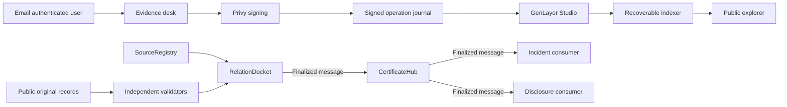

# Architecture and trust

Roots certifies information ancestry within a committed evidence packet. Authority, independence and claim truth are separate questions.

## Authority

The registry deployer is its configured owner. The registry owner or an explicitly signing publisher principal can bind a new publisher identifier to its disclosure custodian. This configuration is an authority delegation within Roots, not proof that a domain, hash or asserted name is a real organization. Validators retrieve the committed public disclosure and original publication independently. They must find public organizational evidence and a distinct original process before affirming independence. An undisclosed organization stays unknown. Shared hosting is not common editorial control.

A publisher principal alone can correct its record or quarantine it. Each correction increments the source revision. The docket checks those revisions at sealing. The hub and both consumers check them again at delivery and action time. No offchain index can clear a restriction.

A registry owner can register successive immutable policy versions. The submitter alone opens its request. Only that owner or an explicitly registered party can appeal an assessed relationship. Anyone can perform a bounded assessment or seal a complete deterministic result. Those permissions confer no publisher or consumer powers.

## Consensus

Each pair contains four complete records: two publications and their organizational disclosures. Each participant retrieves the original public URLs, verifies exact raw byte commitments and every required span, then performs one substantive model evaluation. Captures are audit copies. They cannot prove source authenticity by themselves.

The leader produces a normalized relation, controlling rule, scope, coverage flags and source grounded witnesses. A validator independently reruns the same evidence task and compares those material fields. Model prose is excluded. Witness identifiers are drawn from the committed manifest and sorted canonically. Invalid JSON, invented spans and malformed model output fail validation. Expected deterministic errors must match. VM errors do not establish agreement. Retrieval outages yield an explicit unavailable unknown result.

Sealing has no model call. It requires every pair to have a terminal result, enumerates all subsets, and chooses the earliest maximum in increasing bitmask order. With six sources there are fifteen relations and sixty four subset checks. A subset containing an unknown or shared relation is rejected. Repeated publisher identifiers cannot add two origins. Every independent witness is retained, including relationships outside the selected subset.

## Finality

The docket stores SEALED before publication; this is visibly awaiting publication. It emits to the configured hub only on finalized status. The hub accepts publication only from that docket address and rechecks the authoritative complete batch. It marks the resulting record FINALIZED or UNRESOLVED, retaining the source transaction finality boundary.

A configured consumer subscribes through its own finalized message. Delivery binds consumer, request, policy, subject, manifest, consequence, generation and operation ID. The hub emits the full certificate to the consumer only on finalized status. The consumer authenticates the sender, verifies its configuration and the hub record, enumerates the subset again and persists the last generation and acknowledgement. It acknowledges back to the hub through another finalized message.

A synchronous view is used for conservative freshness checks. It is never used as the initial proof of certificate finality. An accepted correction can suspend decisions earlier than finality, which is deliberately conservative. No unresolved certificate admits evidence into either example consumer.

## Recovery

The web signer passes signed transaction bytes to the server before any broadcast. The API validates signer, chain, zero value, consensus destination, validator count, application contract, method and exact arguments. The journal persists those bytes before submission. On Studio the transaction ID is the hash of signed rollup bytes, which is verified against an authentic retained receipt. A worker can recover a missing hash or repeat the identical broadcast.

The indexer rebuilds each registry, docket history and hub feed through bounded pages. It commits each page and its next checkpoint in one database transaction. Mutable records are revisited on subsequent cycles. The public API exposes a cache timestamp and stale flag. Consumer decisions always read decisive contract state.

## Limits and upgrades

Public manifests contain only public records. Private originals, credentials and private keys do not belong in transaction arguments or persistent contract storage. Source retrieval refuses private IPs, redirects, credentials in URLs, oversized records and invalid text encoding. DNS addresses are checked and pinned for the capture connection.

The declared assessment limit is four records, 48 KiB per record, 16 KiB for the complete packet, and 24 KiB for prompt bytes including metadata and instructions. No text is truncated. Using raw UTF 8 byte length as a conservative token upper bound prevents incomplete packets from being quietly accepted. A six source request is split into pair transactions; no assessment inspects only a fragment of its pair.

Publisher and policy indexes hold at most 4096 entries; batches 1024; docket history and certificates 8192; consumer actions 4096. Views expose pages of at most fifty entries. Sized counters use u32; values are integer quantities. No money or floating point pricing is stored.

Appeal and assessment attempts are limited to three per pair evidence revision. A source revision permits a replacement matrix. Network rotations and finalization remain protocol decisions, outside the worker. Deadlines use the GenVM transaction datetime. Expired unfinished batches expose TIMEOUT and require an owner submitted successor to recover.

Persistent storage fields are declared at class level. Compatible upgrades append fields. Incompatible schema changes require new deployments and explicit registry, hub and consumer rebinding. Existing locked requests do not change policy or consequence.
